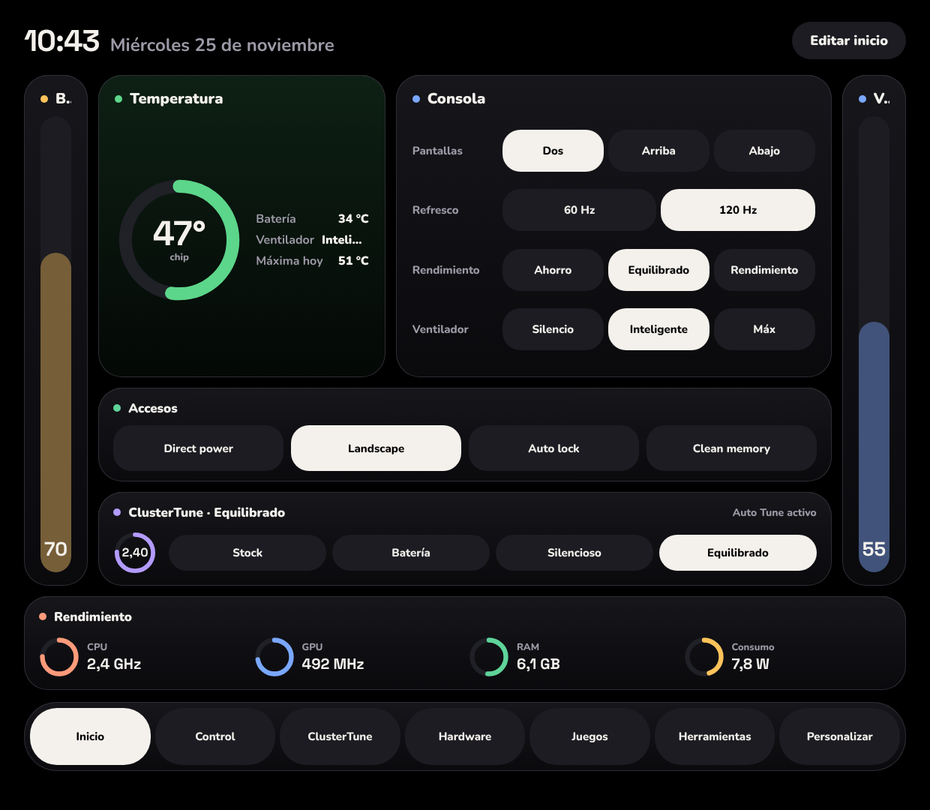
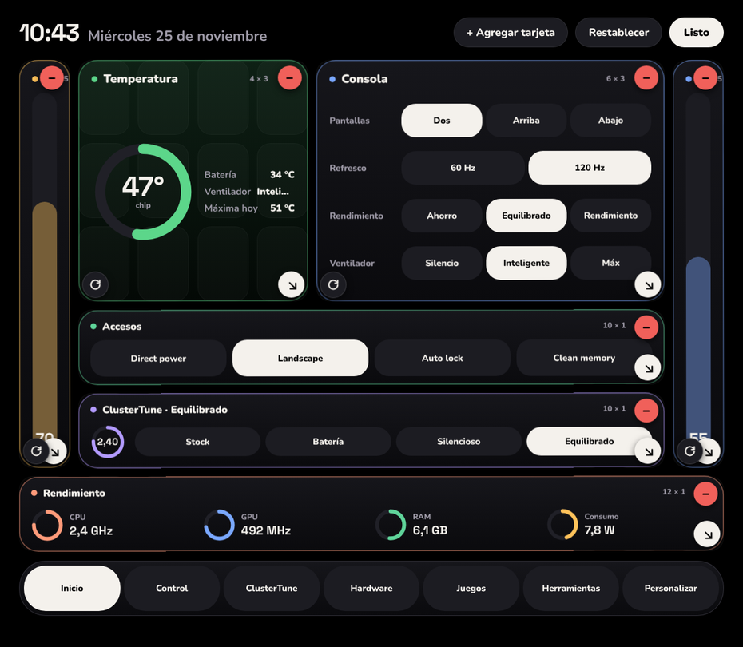
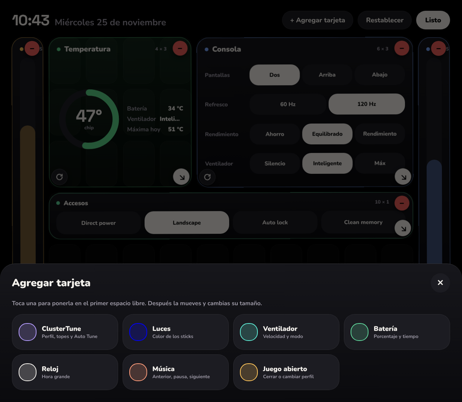
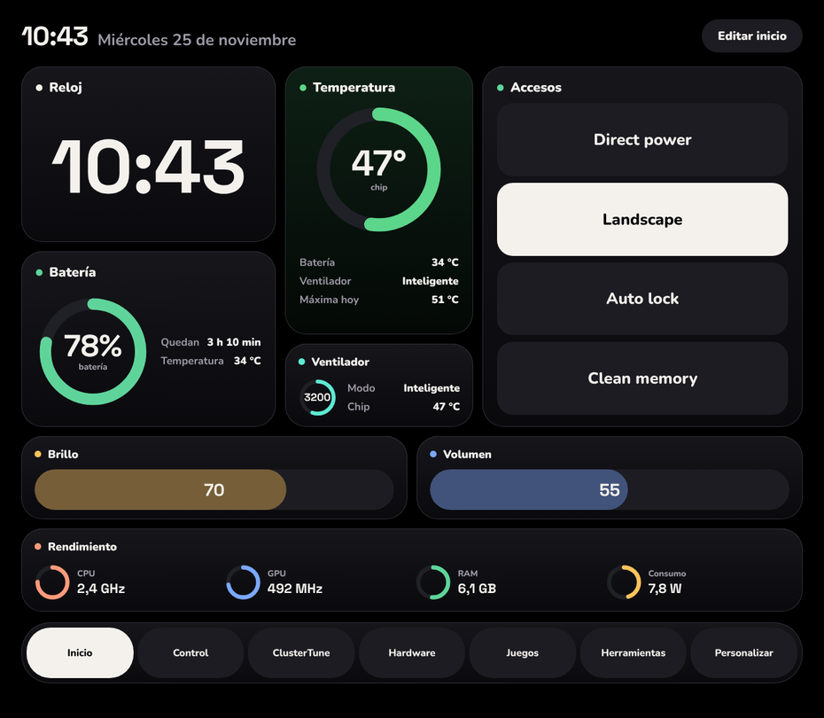
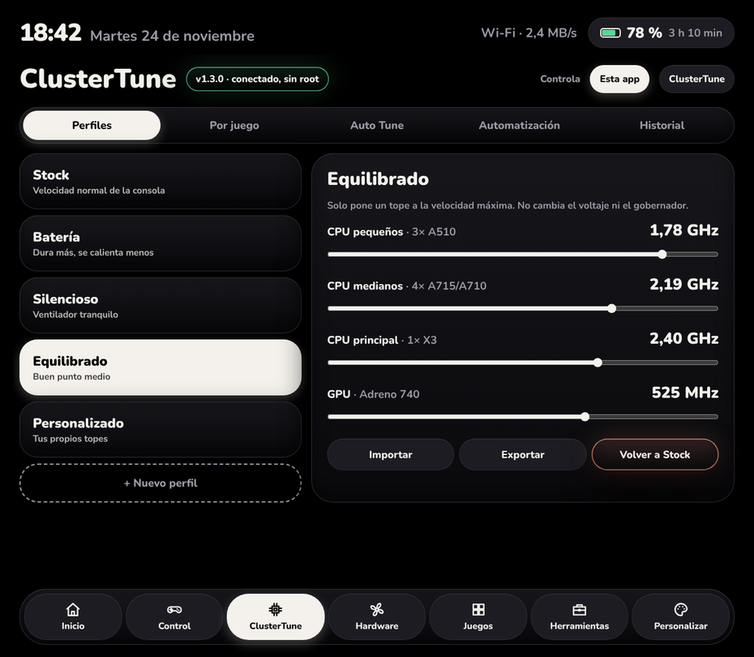
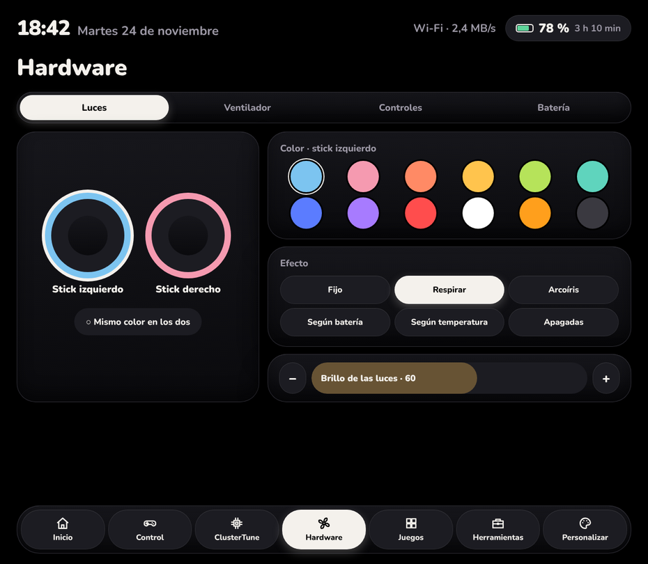
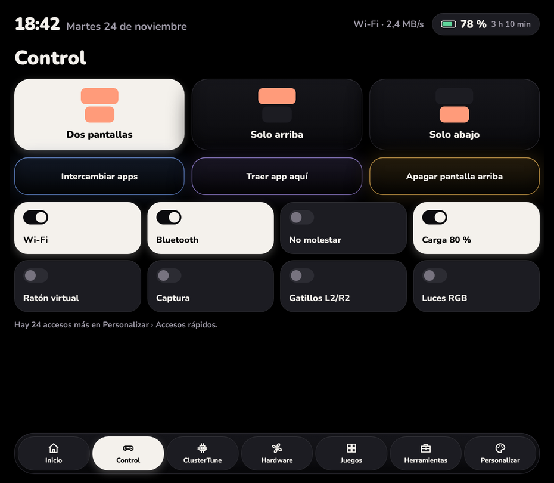
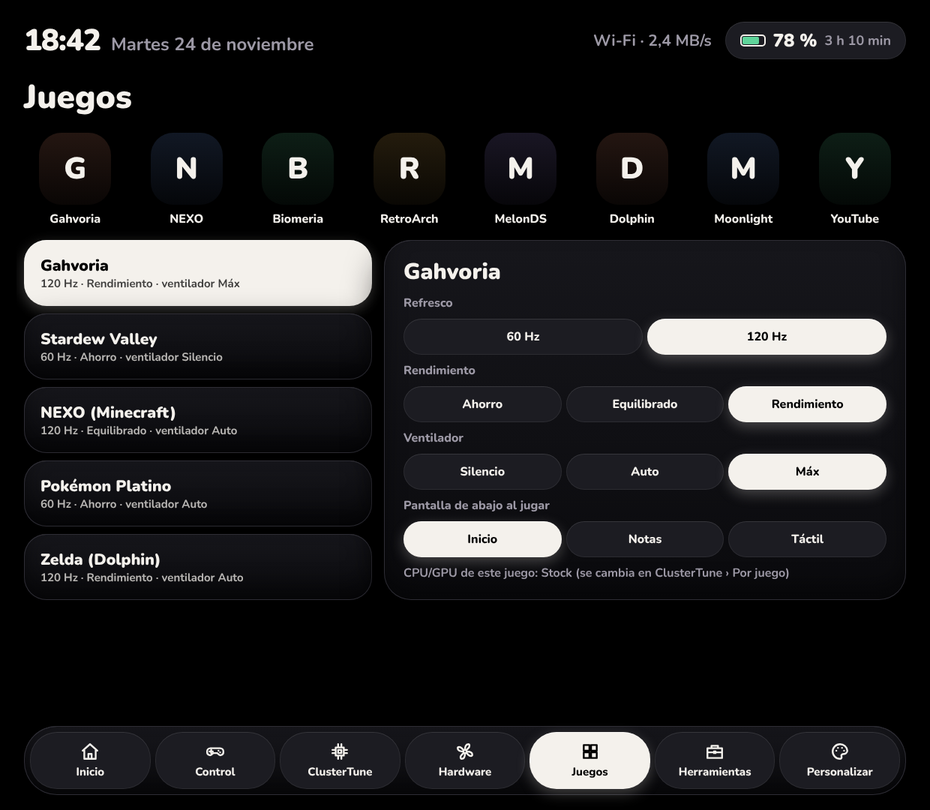
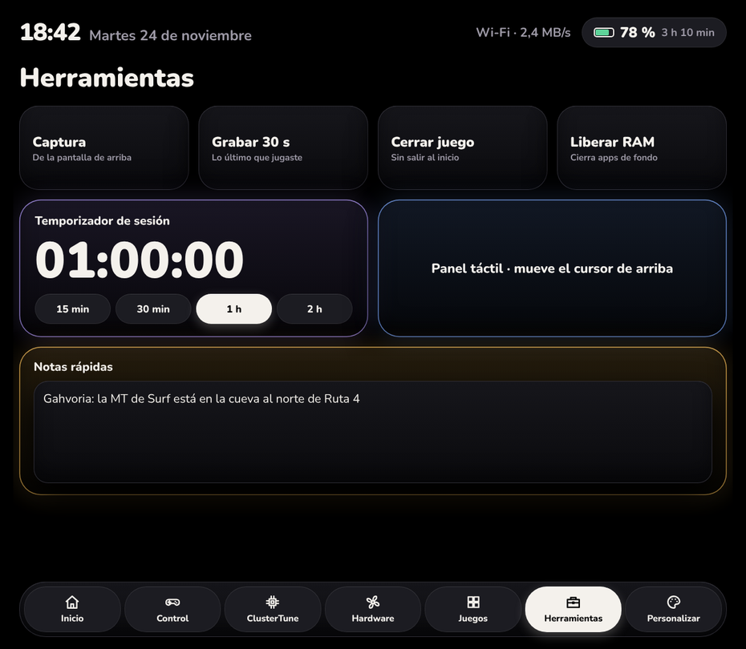
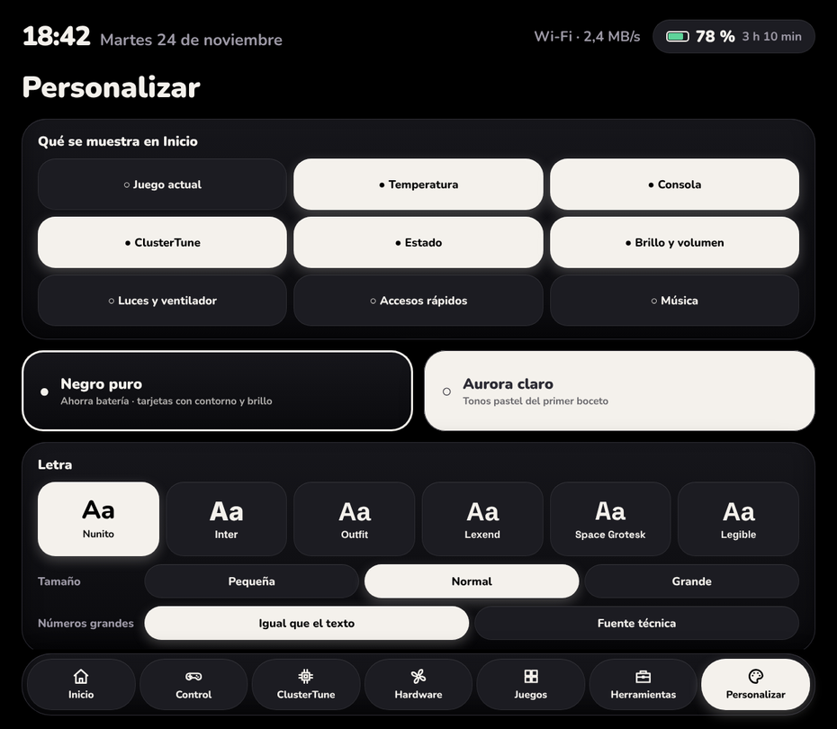

# Integral Dual Screen (IDS)

**Un panel nuevo para la pantalla de abajo de la AYN Thor.**

La Thor trae dos pantallas, pero la de abajo se usa poco: el panel de fábrica muestra un puñado de botones y nada más. IDS la convierte en un tablero de control de verdad, pensado para jugar: ves la temperatura con colores, cambias los modos de la consola, controlas ClusterTune, las luces de los sticks y el ventilador, y ordenas todo a tu gusto, como los widgets de un celular.

Se abre y se cierra con el **botón AYN**, sin cerrar el juego que tienes arriba. Y todo lo que cambias se aplica de verdad en la consola: IDS usa los mismos ajustes que el sistema de AYN, así que la barra de notificaciones y el panel original siempre muestran lo mismo.

Las imágenes de abajo son los bocetos interactivos con los que se diseñó cada pantalla antes de programarla.

## Lo que trae

### Inicio hecho a tu medida
Toca **Editar inicio** y arrastra las tarjetas: las demás se corren para hacerles espacio. Cambia su tamaño desde la esquina, gíralas (↻), quítalas (−) o agrega otras: temperatura, consola, ClusterTune, rendimiento, brillo, volumen, accesos, luces, ventilador, batería, reloj, música y juego abierto. El contenido de cada tarjeta se reacomoda solo según su tamaño, sin cortarse.

| Editar | Agregar tarjetas | Otro orden posible |
|---|---|---|
|  |  |  |

### La consola, a un toque
- **Temperatura con colores**: azul bajo 35 °C, verde normal, naranjo sobre 55 °C y rojo sobre 70 °C.
- **Ventilador inteligente**: sube solo cuando el chip se calienta y baja cuando se enfría.
- Pantallas (dos, solo arriba, solo abajo), 60/120 Hz, modo de rendimiento y brillo de **cada** pantalla.
- Accesos de AYN: **Direct power supply**, **Force landscape**, **Auto lock** y **Clean memory**.

### ClusterTune conectado
Si tienes [ClusterTune](https://github.com/AurelioB/ClusterTune), IDS muestra su perfil activo y su Auto Tune, y abre sus propias ventanas para cambiarlos: las dos apps nunca se contradicen. Sin ClusterTune, IDS pone los topes de CPU y GPU por su cuenta.

| ClusterTune | Luces y hardware | Control |
|---|---|---|
|  |  |  |

### Luces de los sticks
Rueda de colores, intensidad del color y brillo, igual que el panel original, más efectos: respirar, arcoíris, según batería y según temperatura.

### Juegos, herramientas y estilo
Perfiles por juego que se aplican solos al abrirlo, captura, cerrar juego, liberar memoria, temporizador, y personalización completa: **Negro puro** (ahorra batería) o **Aurora claro**, paletas de colores, letras y tamaño.

| Juegos | Herramientas | Personalizar |
|---|---|---|
|  |  |  |

## Instalar
1. Descarga el APK más nuevo desde [Releases](../../releases).
2. Ábrelo en la Thor (pantalla de arriba) y da los permisos que pide.
3. En **Botón AYN**, toca **Aprender botón** y presiona el botón AYN una vez.
4. Deja activado **Ocultar el panel de AYN (recomendado)**: al apretar el botón AYN se cierra el panel de fábrica y queda IDS, sin cortar luces ni ninguna otra función.

Después de eso **se actualiza sola**: busca versiones nuevas, las descarga y las instala cuando cierras el panel.

## Cómo funciona por dentro
- La app usa el servicio interno de la Thor (`PServerBinder`) para iniciar un pequeño ayudante con privilegios ([`ids_helper.sh`](app/src/main/assets/ids_helper.sh)). No hace falta root.
- El ayudante solo acepta una lista fija de órdenes y nunca toca las apps de sistema de AYN que mueven luces, ventilador y controles. Si IDS se cierra, deja todo como estaba.
- Los ajustes reales de AYN que usa IDS están documentados en [`docs/ayn-thor-ajustes.md`](docs/ayn-thor-ajustes.md).
- Cada cambio en `main` se compila, se firma y se publica solo en Releases.

## Firma
Las versiones oficiales se firman con la llave del proyecto (`signing/ids-release.p12`), protegida por la contraseña guardada en el secreto `IDS_KEYSTORE_PASSWORD` del repositorio. Huella SHA-256:
`08:9B:78:72:95:E3:6B:BE:38:D9:32:56:F1:D9:36:80:96:5A:52:D9:83:48:3F:37:12:A6:7F:D7:20:AF:B9:CC`

Otros secretos opcionales: `IDS_REPORT_URL` (reportes de error automáticos).

## Créditos
- Cliente de `PServerBinder` basado en [ClusterTune](https://github.com/AurelioB/ClusterTune) (MIT).
- Letras de Google Fonts (licencia OFL), descargadas al compilar.
